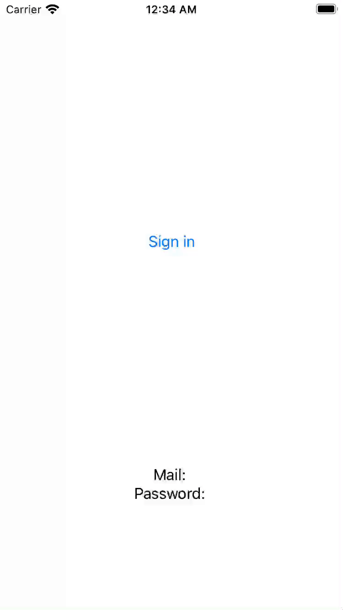

# TextFieldAlert

A SwiftUI alert with text fields for iOS 13+ and tvOS 13+.

On iOS 17 and later, TextFieldAlert uses the native SwiftUI alert implementation by default. On earlier iOS versions and tvOS, it uses a UIKit-backed implementation. Set `alwaysPreferUIKit` to `true` to use the UIKit implementation on iOS 17 and later as well.

## Requirements

- iOS 13.0+ or tvOS 13.0+
- Swift 5.1+

## Installation

You can add TextFieldAlert to an Xcode project as a Swift package dependency.

1. From the **File** menu, select **Add Packages…**
2. Enter `https://github.com/sochalewski/TextFieldAlert` in the package repository URL field.
3. Add the package to your app target.

## Usage

The package adds `textFieldAlert(...)` to `View`:

```swift
@ViewBuilder
func textFieldAlert(
    title: String?,
    message: String? = nil,
    textFields: [TextFieldAlert.TextField],
    actions: [TextFieldAlert.Action],
    isPresented: Binding<Bool>,
    alwaysPreferUIKit: Bool = false
) -> some View
```

You can use it in your code as follows:

```swift
import SwiftUI
import TextFieldAlert

struct ExampleView: View {
    
    @State private var isPresented = false
    @State private var text1 = ""
    @State private var text2 = ""
    
    var body: some View {
        VStack {
            Button {
                isPresented = true
            } label: {
                Text("Alert")
            }
            
            Text(text1)
            Text(text2)
        }
        .textFieldAlert(
            title: "Title",
            message: "Message",
            textFields: [
                .init(text: $text1),
                .init(text: $text2)
            ],
            actions: [
                .init(title: "OK")
            ],
            isPresented: $isPresented
        )
    }
}
```

Each action closure receives the current text values in the same order as the text fields passed to `textFieldAlert`. The [Example app](Example/TextFieldAlertExample) demonstrates advanced usage, including moving presentation state into a view model, customizing text fields, and enabling action buttons conditionally.



## Author

Piotr Sochalewski, [sochalewski.github.io](https://sochalewski.github.io)

TextFieldAlert is heavily inspired by [tanzolone](https://stackoverflow.com/users/3033314/tanzolone)'s [answer](https://stackoverflow.com/a/61902990) on Stack Overflow.

## License

TextFieldAlert is available under the MIT license. See the [LICENSE](LICENSE) file for more information.
